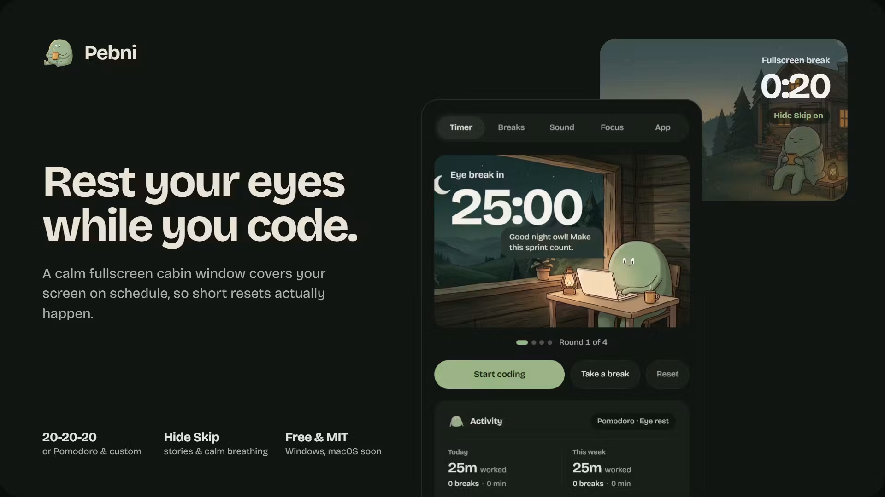

<p align="center">
  
</p>

<h1 align="center">Pebni</h1>

<p align="center">
  <b>A break app for developers who keep skipping their breaks.</b><br />
  Free, open source and local-first. Windows now, macOS soon.
</p>

<p align="center">
  <a href="https://github.com/Elamin-svg/pebni/releases/latest/download/win-x64-Pebni-Setup.zip"><b>Download for Windows</b></a>
  ·
  <a href="https://github.com/Elamin-svg/pebni/releases/latest">All releases</a>
  ·
  <a href="LICENSE">MIT License</a>
</p>

---

## What is Pebni?

Pebni is a small desktop app that reminds you to rest your eyes while you code, and makes sure the break actually happens.

Corner popups are easy to click away. By 6 p.m. your eyes are dry and simple bugs look hard. Pebni covers every screen with a calm, illustrated cabin scene for a short break, then gets out of your way. It waits for your calls and your train of thought, and it lives quietly in the system tray.

And yes, it comes with a cute mascot. Pip rests with you on every break.

## Why developers use it

- **Breaks you can't swipe away.** The break fills every monitor. Turn on Hide Skip and short breaks run until they end.
- **It waits for your flow.** After steady typing, a break waits for a natural pause (up to 5 minutes). Need longer? Tap "Give me 2 minutes".
- **It waits for your calls.** Breaks hold during Zoom, Teams, screen shares, fullscreen demos and any app you add, then start the moment you're free.
- **Your schedule, not ours.** One-click 20-20-20 and Pomodoro presets, or any work and break length you choose, plus optional long breaks.
- **A break that calms you down.** Guided breathing (4 s in, 6 s out), short stories, nature sounds, or just a soft chime.
- **Out of your way.** Starts in the tray at login, can mute other apps' audio during breaks, and lets you close long breaks with `Esc` while the timer keeps running.
- **Private by default.** No account and no telemetry. Settings and your 7-day break history stay on your machine.

## Install

1. Download [`win-x64-Pebni-Setup.zip`](https://github.com/Elamin-svg/pebni/releases/latest/download/win-x64-Pebni-Setup.zip) from the latest release.
2. Unzip it and run the setup.
3. Pebni starts in your system tray. Pick a preset and get back to coding.

macOS builds are coming once testing on Mac hardware is done. Watch the [releases](https://github.com/Elamin-svg/pebni/releases) for updates.

## Run from source

This repository holds two independent workspaces:

| Workspace | Stack | What it is |
| --- | --- | --- |
| [`apps/desktop`](apps/desktop) | Electrobun, Bun, Vite, TypeScript, Tailwind v4, daisyUI 5 | The Pebni desktop app |
| [`apps/web`](apps/web) | Astro | The landing page and downloads site |

The desktop app never imports from the website. `apps/desktop/src/core/architecture.test.ts` checks this on every test run.

```bash
# Desktop app (needs Hutch: https://github.com/blackboardsh/hutch)
cd apps/desktop
hutch install
hutch run start                         # build and launch the app
hutch run dev:hmr                       # launch with Vite hot reload
hutch test src/core                     # unit + architecture tests
hutch pm exec -- tsc --noEmit -p .      # type check
hutch pm exec -- vite build             # build the WebView bundle
node scripts/test-e2e.mjs               # real-browser E2E suite

# Website
cd apps/web
npm install
npm run dev                             # Astro dev server
npm run build                           # static production build
```

The desktop app is a hexagonal modular monolith: a pure TypeScript core, explicit ports, and Bun and WebView adapters. See [ADR 001](apps/desktop/docs/adr/001-hexagonal-modular-architecture.md) for the details.

## Contributing

Bug reports, ideas and pull requests are welcome. Start with [CONTRIBUTING.md](apps/desktop/CONTRIBUTING.md), and please follow the [Code of Conduct](apps/desktop/CODE_OF_CONDUCT.md). Security issues go through [SECURITY.md](apps/desktop/SECURITY.md).

## License

[MIT](LICENSE). Free to use, change and share.
